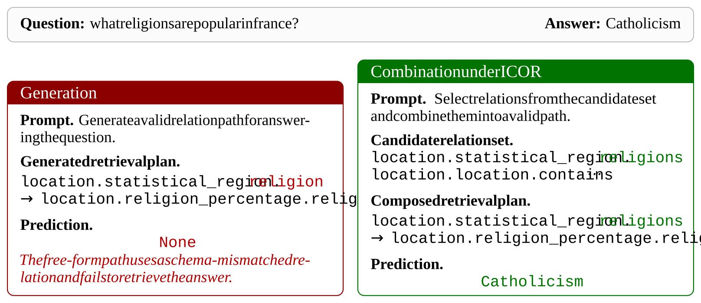

# ICOR

### Interactive Combinatorial Reinforcement Learning for Knowledge Graph Reasoning

**Graph-grounded exploration. Multi-turn interaction. Dependency-aware reinforcement learning.**

[Overview](#overview) · [Method](#method) · [Results](#results) · [Code and Data](#code-and-data)

## Overview

**ICOR** is an **Interactive Combinatorial Reinforcement Learning** framework for learning multi-turn knowledge graph question answering (KGQA) with smaller, open-source language models.

A relation path can be linguistically plausible yet impossible to execute on a knowledge graph. In on-policy reinforcement learning, these failed rollouts leave the model with sparse or uninformative feedback. ICOR addresses this problem **before rollout sampling**: it retrieves a query-specific set of candidate relations and grounds policy exploration in compositions of those relations, rather than unconstrained relation-path generation.

Starting from an SFT-initialized policy, ICOR applies **Group Relative Policy Optimization (GRPO)** with staged feedback, progressing from interaction validity and path discovery to answer-consistent reasoning.

> **Core idea:** Use graph constraints to shape the exploration space for policy learning—not merely to validate generated paths after the fact.

## Method

### 1. Construct a query-specific relation space

A dense dual encoder retrieves the top-K relations relevant to the question. These candidates form the building blocks of the policy's relation-path actions. The policy composes paths from this graph-derived space, executes them on the KG, and uses the returned entities and execution history to guide subsequent interaction.

The default retriever is **Qwen3-Embedding-0.6B**, trained with a contrastive InfoNCE objective, with **K = 30** candidate relations. Restricting relation names reduces schema mismatch; graph execution remains necessary to determine whether a composed path is reachable from the current entities.

### 2. Initialize the policy with an SFT cold start

ICOR initializes **Qwen2.5-7B-Instruct** using relation-path annotations from **RoG** mixed with general instruction data from **Alpaca** at an **8:2** ratio. This gives the policy a starting point for valid relation-path generation while retaining general instruction-following ability.

### 3. Optimize with dependency-aware staged GRPO

Path discovery and answer prediction are conditionally dependent. ICOR therefore applies rewards over progressively filtered rollout groups, rather than combining every reward over every trajectory throughout training.

| Stage | Trajectories used for optimization | Feedback | Training steps |
|:--|:--|:--|--:|
| 1 | Full sampled group | Syntax + path rewards | 500 |
| 2 | Syntactically valid trajectories | Path reward | 200 |
| 3 | Trajectories with correct relation paths | Answer F1 reward | 200 |

Relative advantages are normalized within each stage's valid subset. Empty subsets are skipped. The resulting updates separate format failures, path-search failures, and answer-selection failures.

**Supervision.** ICOR learns from self-explored interaction trajectories, reducing dependence on manually annotated multi-turn demonstrations. It still uses relation-path supervision for retrieval and SFT, a correct-path set for the path reward, and ground-truth answers for the answer F1 reward.

### A concrete example: faithful retrieval

  

*Figure 2 from the paper. For “what religions are popular in france?”, a free-form plan uses `location.statistical_region.religion` instead of the KG relation `location.statistical_region.religions`. ICOR selects the graph's actual relation and composes an executable retrieval path.*

## Results

All scores below are reported in the paper, on a 0–100 scale. **Hits@1** measures top-ranked answer correctness; **F1** measures overlap between predicted and ground-truth answer sets.

### WebQSP and CWQ

Both benchmarks use **Freebase** as the background knowledge graph. The table shows selected KG-augmented baselines from Table 1 of the paper.

| Method | WebQSP Hits@1 | WebQSP F1 | CWQ Hits@1 | CWQ F1 |
|:--|--:|--:|--:|--:|
| RoG | 83.2 | 69.8 | 61.4 | 56.2 |
| GNN-RAG | 85.7 | 71.3 | 66.8 | 59.4 |
| ToG (GPT-4) | 81.8 | 75.9 | 68.5 | 60.2 |
| SubgraphRAG (GPT-4o) | 90.9 | 78.2 | 67.5 | 59.4 |
| PoG (GPT-4) | 87.3 | — | 75.0 | — |
| **ICOR (Qwen2.5-7B-Instruct)** | **88.8** | **75.4** | **69.5** | **61.3** |

ICOR improves both Hits@1 and F1 over RoG and GNN-RAG on both datasets, using a locally deployable 7B policy model. A dash indicates a value not reported in the paper's comparison table.

### Accuracy–efficiency trade-off

Average LLM calls and latency per question on **WebQSP**, from Table 2 of the paper:

| Method | LLM calls ↓ | Latency (s) ↓ | Hits@1 ↑ |
|:--|--:|--:|--:|
| ToG | 16.3 | 63.9 | 81.8 |
| RoG | 2.0 | 1.5 | 83.2 |
| **ICOR** | **3.6** | **4.1** | **88.8** |

Compared with ToG, ICOR requires substantially fewer LLM calls and lower latency while achieving higher Hits@1. Relative to RoG, ICOR trades additional interaction cost for better answer accuracy. These timing results reflect the experimental setting reported in the paper.

### Beyond Freebase: MetaQA-3hop

MetaQA-3hop uses the **WikiMovies** knowledge graph. The paper evaluates both direct transfer of the Freebase-trained model and a separate in-domain fine-tuning setting (Tables 11–12).

| Setting | Method | Hits@1 | F1 |
|:--|:--|--:|--:|
| Zero-shot transfer from Freebase | ICOR | 52.7 | 47.8 |
| Fine-tuned on MetaQA-3hop | RoG | 89.0 | 50.7 |
| Fine-tuned on MetaQA-3hop | GNN-RAG | 93.3 | 62.9 |
| **Fine-tuned on MetaQA-3hop** | **ICOR** | **95.1** | **69.3** |

The zero-shot result uses no additional fine-tuning on the target KG and should not be conflated with the in-domain fine-tuned results.

<strong>Ablation: staged optimization and reward components</strong>

CWQ results from Table 5 of the paper:

| Variant | Hits@1 | F1 |
|:--|--:|--:|
| **ICOR** | **69.5** | **61.3** |
| Without staged filtering | 66.7 | 59.1 |
| Without syntax reward | 67.8 | 59.5 |
| Without path reward | 65.2 | 57.4 |
| Without answer reward | 63.1 | 56.3 |

Both staged filtering and the individual reward components contribute to performance. Removing the path or answer reward produces larger drops than removing the syntax reward.

## Experimental Configuration

<strong>Default models, hyperparameters, and training resources</strong>

Settings below are reported in Section 4.1 and Appendix A.4 of the paper.

| Component | Setting |
|:--|:--|
| Policy backbone | Qwen2.5-7B-Instruct |
| Relation retriever | Qwen3-Embedding-0.6B |
| Candidate relations | Top-K, K = 30 |
| Maximum interaction horizon | 4 interaction steps |
| Rollout group size | 8 trajectories per query |
| Rollout temperature | 0.7 |
| Maximum sequence length | 8,192 tokens |
| SFT data mixture | RoG : Alpaca = 8 : 2 |
| Retriever training | 10 epochs; learning rate 2e-5; batch size 128 |
| SFT training | 3 epochs; learning rate 2e-5; global batch size 128 |
| Initial RL learning rate | 1e-5 |
| KL coefficient | 0.05 |
| Beam size | 5 |
| Experimental hardware | 4 × NVIDIA H20 GPUs, 96 GB per GPU |

**Reward values.** The implementation uses +0.2 for syntactically valid outputs and −0.03 otherwise; +0.7 for a generated path belonging to the correct-path set and 0 otherwise; and answer-set F1 in [0, 1] for the answer reward. Each stage applies these rewards only to its designated trajectory subset.

## Scope and Limitations

ICOR depends on the quality and connectivity of the underlying KG and the recall of the relation retriever. Missing graph edges, incorrect schemas, or excluded relevant relations can prevent successful reasoning. The SFT and staged RL training also introduce overhead compared with prompting-only approaches. Evaluation beyond the reported Freebase and WikiMovies benchmarks remains future work.

## Code and Data

Code and data will be released upon acceptance, as described in the paper. This initial repository provides the method overview and reported experimental results.

## Citation

The public paper link and complete BibTeX entry will be added with the bibliographic details.

## Acknowledgments

This work builds on Qwen models, RoG relation-path annotations, Alpaca instruction data, and the WebQSP, CWQ, and MetaQA benchmarks with their underlying Freebase and WikiMovies knowledge graphs. We thank the authors and maintainers of these resources.
